# Terrain Manager

The Terrain Manager loads a terrain and provides helpful function, like calculating your robot's hight above a varied terrain, or placing it at random places around a specific subterrain.

You can see a full example in [examples/rough_terrain](https://github.com/jgillick/genesis-forge/tree/main/examples/rough_terrain).

<video autoplay="" muted="" loop="" playsinline="" controls="" src="../../media/terrain.webm"></video>

## Basic Usage

Define your terrain as a `TerrainLayout`, a grid of subterrains. Then pass it to the terrain manager.

```python
from genesis_forge import terrain
from genesis_forge.managers import TerrainManager

class MyEnv(ManagedEnvironment):
    def __init__(self, *args, **kwargs):
        super().__init__(*args, **kwargs)

        self.scene = gs.Scene()

        # Define your terrain, and add it to the scene
        self.terrain_layout = terrain.TerrainLayout(
            self.scene,
            subterrain_size=(15, 15),
            grid=[
                terrain.Flat(name="flat"),
                terrain.RandomUniform(name="rough"),
            ],
        )

    def config(self):
        # Load your terrain into the manager
        self.terrain_manager = TerrainManager(self, layout=self.terrain_layout)

        # Place the robot at random places on the flat subterrain
        self.robot_manager = EntityManager(
            self,
            entity=self.robot,
            on_reset={
                "position": {
                    "fn": reset.randomize_terrain_position(
                        terrain_manager=self.terrain_manager,
                        subterrain="flat",  # <~ the subterrain name from your grid
                        height_offset=0.3,  # place the robot this high above the terrain
                    ),
                },
            },
        )

        # Reward height above the terrain
        self.reward_manager = RewardManager(
            self,
            logging_enabled=True,
            cfg={
                "base_height_target": {
                    "weight": -50.0,
                    "fn": rewards.base_height(
                        target_height=0.3,
                        terrain_manager=self.terrain_manager,
                    ),
                },
            }
        )
```

## Terrain layouts

The entire terrain is built of a 2-dimensional grid of subterrains, stiched together to create one surface. 

For example, your terrain grid might contain a flat subterrain, one that's wavy, a rough subterrain, and a terrain that looks like a stepped pyramid.

```python

self.terrain_layout = terrain.TerrainLayout(
    self.scene,
    subterrain_size=(12, 12),
    grid=[  # <~ grid[x][y]
        [
            terrain.Flat(name="flat"), 
            terrain.Wave(name="wavey"),
        ],
        [
            terrain.RandomUniform(name="rough", max_height=0.08),
            terrain.PyramidStairs(name="stairs"),
        ],
    ],
)
```

The layout adds itself to the scene, and you'll find the terrain entity at `self.terrain_layout.entity`.

Without a `surface` arg, the terrain gets a blue checkerboard of half-meter squares, which makes it easy to see how big things are and how the ground is shaped. Pass `surface=gs.surfaces.Default()` if you'd rather have plain ground.


### Subterrain types

| Class | Terrain | |
|-------|---------|-|
| `Flat` | Flat ground | [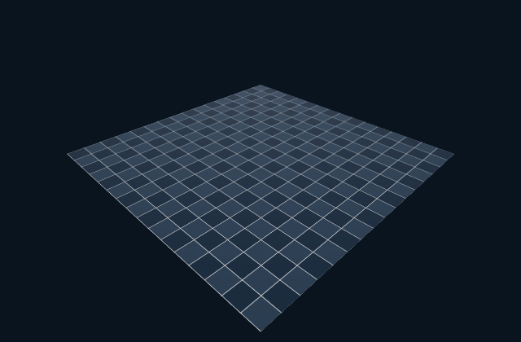{ width="240" }](../../media/terrains/Flat.png) |
| `Fractal` | Rolling, natural-looking ground | [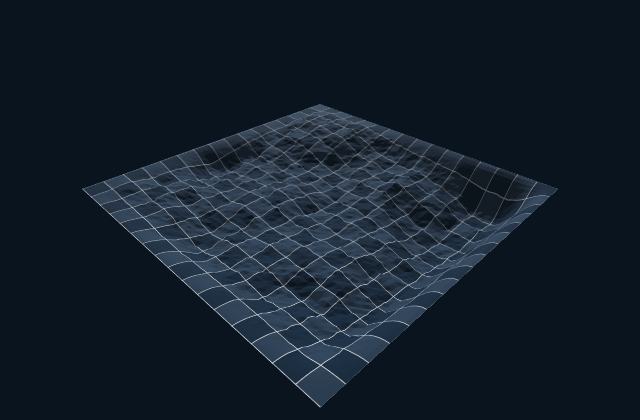{ width="240" }](../../media/terrains/Fractal.png) |
| `RandomUniform` | Random bumps | [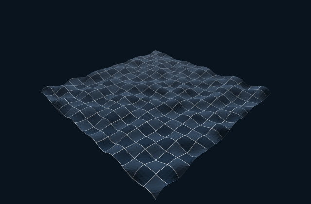{ width="240" }](../../media/terrains/RandomUniform.png) |
| `Wave` | Smooth waves | [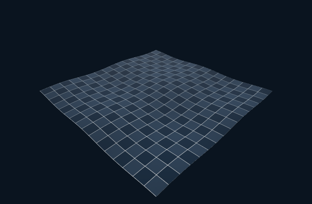{ width="240" }](../../media/terrains/Wave.png) |
| `Sloped` | A ramp | [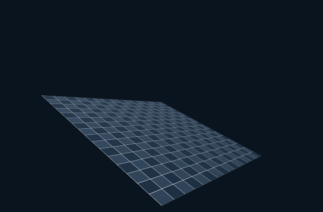{ width="240" }](../../media/terrains/Sloped.png) |
| `PyramidSloped` | Slopes up to a center platform (shown with `slope=0.4`; the default is a gentler 0.1) | [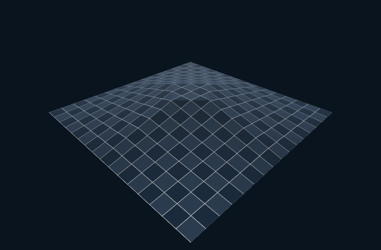{ width="240" }](../../media/terrains/PyramidSloped.png) |
| `Stairs` | A staircase | [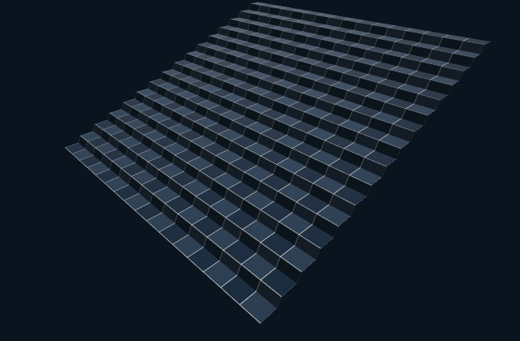{ width="240" }](../../media/terrains/Stairs.png) |
| `PyramidStairs` | Stairs up to a center platform | [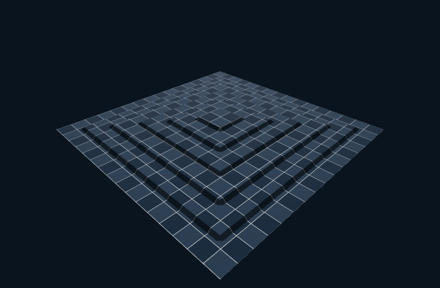{ width="240" }](../../media/terrains/PyramidStairs.png) |
| `SteppingStones` | Stones with gaps between them | [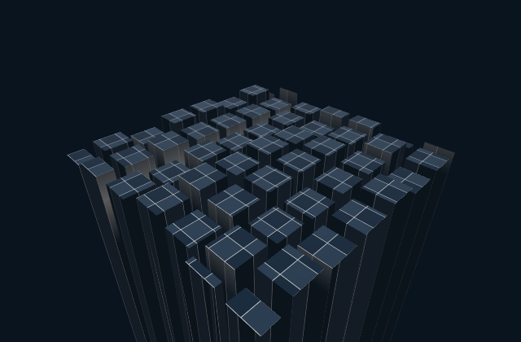{ width="240" }](../../media/terrains/SteppingStones.png) |
| `DiscreteObstacles` | Flat ground with random blocks | [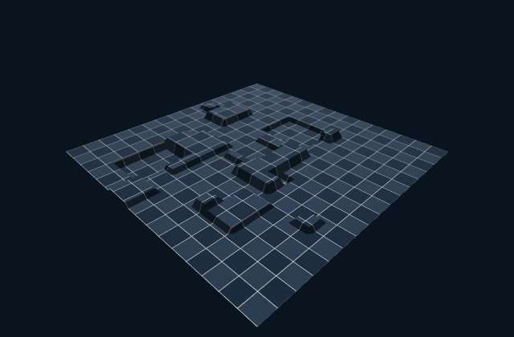{ width="240" }](../../media/terrains/DiscreteObstacles.png) |
| `RandomGrid` | Square blocks at random heights around a raised platform (from mjlab) | [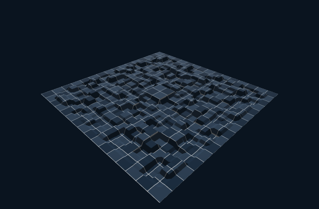{ width="240" }](../../media/terrains/RandomGrid.png) |
| `HeightField` | Your own heights, in meters | |


### Your own subterrain

Subclass `Subterrain` and return a numpy height field grid, in meters:

```python
from dataclasses import dataclass
from typing import ClassVar

import numpy as np
from genesis_forge import terrain


@dataclass(kw_only=True)
class Step(terrain.Subterrain):
    type: ClassVar[str] = "step"
    height: float = 0.1

    def generate(self, shape, horizontal_scale, vertical_scale):
        heights = np.zeros(shape)
        heights[shape[0] // 2 :, :] = self.height  # <~ raise the far half
        return heights
```

You can also build on one of Genesis' terrain generators.

```python
from genesis.ext.isaacgym import terrain_utils


@dataclass(kw_only=True)
class ChoppyWaves(terrain.Subterrain):
    type: ClassVar[str] = "choppy_waves"

    def generate(self, shape, horizontal_scale, vertical_scale):
        genesis_terrain = self.empty_genesis_terrain(shape, horizontal_scale, vertical_scale)
        terrain_utils.wave_terrain(genesis_terrain, num_waves=4, amplitude=0.1)
        terrain_utils.random_uniform_terrain(  # <~ add bumps on top of the waves
            genesis_terrain, min_height=-0.02, max_height=0.02, step=0.01, downsampled_scale=0.5
        )
        return self.genesis_heights(genesis_terrain)  # <~ the heights, in meters
```

## Placing robots

Using reset functions, like `randomize_terrain_position`, you can specify which subterrains you want robots placed on by name.

```python
reset.randomize_terrain_position(
    terrain_manager=self.terrain_manager,
    subterrain=["start", "rough"],  # <~ a random pick for each robot
)
```

It can also be a lambda:

```python
reset.randomize_terrain_position(
    terrain_manager=self.terrain_manager,
    subterrain=lambda: "rough" if is_advanced else "flat"
)
```

Or specify the subterrain per environment:

```python
flat_idx = self.terrain_manager.index("flat")
self.env_terrain = torch.full((self.num_envs,), flat_idx)

...

reset.randomize_terrain_position(
    terrain_manager=self.terrain_manager,
    subterrain=self.env_terrain
)
```


### A subterrain for each robot

```python
def config(self):
    # All robots start on the flat terrain
    self.terrain_manager = TerrainManager(self, layout=self.terrain_layout)
    flat_idx = self.terrain_manager.index("flat")
    self.env_terrain = torch.full((self.num_envs,), flat_idx)

    self.robot_manager = EntityManager(
        self,
        entity=self.robot,
        on_reset={
            "position": {
                "fn": reset.randomize_terrain_position(
                    terrain_manager=self.terrain_manager,
                    subterrain=self.env_subterrain_idx,
                    height_offset=HEIGHT_OFFSET,
                ),
            },
        },
    )

def promote(self, envs_idx):
    # Based on the curriculum conditions,
    # promote an environment to the rough subterrain 
    self.env_terrain[envs_idx] = self.terrain_manager.index("rough")
```

The [terrain curriculum example](https://github.com/jgillick/genesis-forge/tree/main/examples/terrain_curriculum) puts this together: robots start on flat ground and move to rougher levels as they get better at walking.

## Height scan

A height scan lets your robot see the ground around it. It's a grid of terrain heights under and in front of the robot, measured relative to its base:

```python
ObservationManager(
    self,
    name="critic",  # <~ only the critic sees it (more on that below)
    cfg={
        "height_scan": {
            "fn": observations.height_scan(
                terrain_manager=self.terrain_manager,
                entity_manager=self.robot_manager,
                offset=0.3,  # <~ your robot's standing height
            ),
            "noise": 0.1,
            "clip": (-1.0, 1.0),
        },
        # ...the rest of your critic observations...
    },
)
```

By default, the grid is 1.6 x 1.0 meters with a point every 10 cm (187 heights). It turns with the robot, but stays level when the robot tilts. Change it with `size` and `resolution`.

Set `offset` to your robot's standing height, so flat ground reads close to 0 (it's 0 by default). It also decides which heights fit inside the clip: with `clip=(-1, 1)`, the robot sees from `1 + offset` meters below its base to `1 - offset` meters above it.

Your real robot probably doesn't have a height map, so give the scan to the critic only. Training gets the extra information, and the policy you deploy only needs its usual sensors. If you do put it in the `"policy"` observations, your robot will need to build its own height map.

The scan only sees the terrain, not other objects in the scene.

## Using gs.morphs.Terrain

The terrain manager still works with a regular Genesis terrain:

```python
self.terrain = self.scene.add_entity(
    morph=gs.morphs.Terrain(
        n_subterrains=(1, 3),
        subterrain_size=(12, 12),
        subterrain_types=[["flat_terrain", "random_uniform_terrain", "flat_terrain"]],
    ),
)
...
self.terrain_manager = TerrainManager(self, terrain=self.terrain)
```

Here, subterrains are named after their type. When a type shows up more than once, it gets numbered: `flat_terrain_0`, `random_uniform_terrain`, and `flat_terrain_1`. Using plain `flat_terrain` places robots on either one.

That's the same naming a `TerrainLayout` uses for repeated names. But Genesis gives every subterrain of a type the same settings, so use a `TerrainLayout` when you want them to differ.

## Terrain Utilities

### Get height at X/Y position

```python
# Get height at robot position
robot_pos = self.robot.get_pos()
terrain_height = self.terrain_manager.get_terrain_height(robot_pos[:, 0], robot_pos[:, 1])
```

On a terrain, this asks Genesis for the exact surface your robot is standing on. On a flat `gs.morphs.Plane`, it's just the plane's height.

Other ground, like a mesh, doesn't have a height lookup. You can turn a mesh into a terrain with Genesis' `mesh_to_heightfield()`, or use your own heights with `terrain.HeightField`.

### Generate random locations around a subterrain

Get 10 random positions on the flat subterrain:

```python
pos = self.terrain_manager.generate_random_positions(num=10, subterrain="flat")
```

Or place robots from your own reset function:

```python
def reset(envs_idx: torch.Tensor | Sequence[int]):
    pos = terrain_manager.generate_random_env_pos(
        envs_idx=envs_idx,
        subterrain=["flat", "rolling"],
        height_offset=0.4,
    )
    self.robot.set_pos(pos, envs_idx=envs_idx)
```

### Look up subterrains

```python
self.terrain_manager.subterrain_names    # ["flat", "rolling"]
self.terrain_manager.index("rolling")    # 1
self.terrain_manager.get_bounds("flat")  # (x_min, x_max, y_min, y_max)
```

All of this comes from `self.terrain_manager.terrain_map`, which also has each subterrain's type and bounds. It works the same whether your terrain is a `TerrainLayout` or a plain `gs.morphs.Terrain`.
